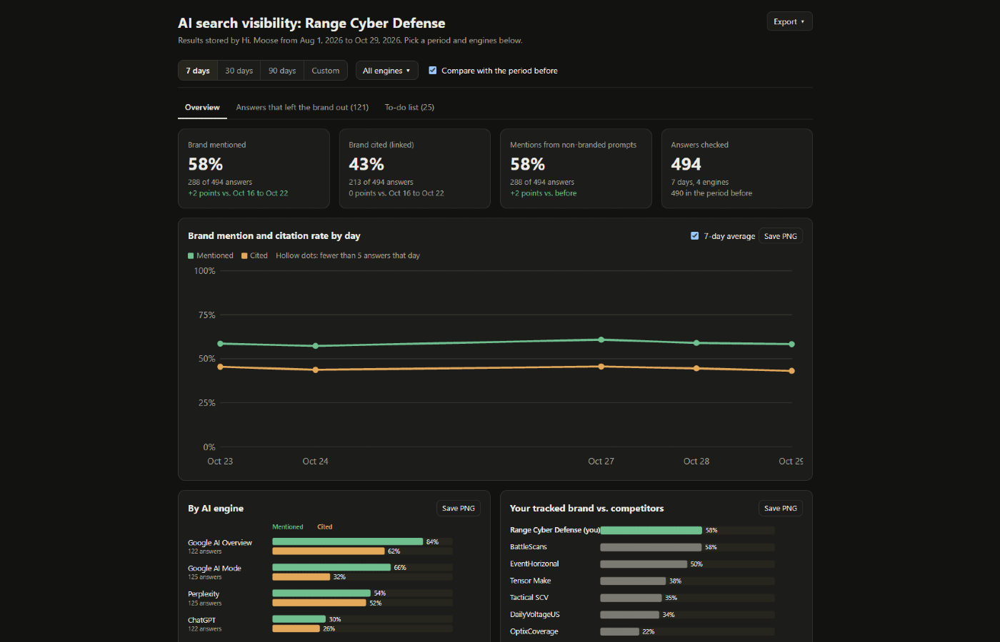

# AEO skills for Claude and ChatGPT

Open source skills by [Hi, Moose](https://himoose.com) for answer engine optimization (AEO), also called generative engine optimization (GEO) or AI SEO: getting your brand mentioned and cited in the answers ChatGPT, Perplexity, Google AI Overviews, Google AI Mode, Gemini and Grok give. Use them inside Claude, ChatGPT or your coding agent.

| Skill | What it does |
|---|---|
| [`ai-visibility`](skills/ai-visibility/SKILL.md) | AI search visibility dashboard, report and to-do list from your Hi, Moose results. |

More skills are on the way. Each one lives in its own folder under `skills/`.

## ai-visibility

See how AI engines talk about your brand: how often they mention and cite you, against which competitors, and what to fix.



### What you can ask for

| Ask | You get |
|---|---|
| "Build my AI search visibility dashboard." or "How are we doing in AI search?" | An interactive dashboard (the default): pick 7, 30 or 90 days or your own dates, compare with the period before, filter by AI engine, hover over any chart for the numbers, see your tracked brand against competitors and the answers that left you out, and work through your to-do list with "Open in Hi, Moose" buttons. Save charts as PNG, the numbers as CSV and the page as PDF. |
| "Write my AI search visibility report as text for an email." | A short written report: how often AI engines mention and cite your brand, what changed since the period before, results by engine and topic, competitors, quoted answers and next steps. |
| "What should I work on this week to show up more in AI search?" | Your open fixes, ranked: the top five in full with the prompts, engines and competitors behind them, the rest one line each. |

The skill only reads results Hi, Moose has already stored. It never runs new checks, changes settings or publishes anything.

## Quick start

1. **Get Hi, Moose (free).** [Download the desktop app](https://himoose.com/downloads/), add your site and the prompts you want to track, and run your first visibility check.
2. **Connect Hi, Moose to your AI app.** Add a custom connector with the address `https://mcp.himoose.com/mcp` and sign in with your Hi, Moose account. [Step-by-step for Claude, ChatGPT and others](https://himoose.com/docs/integrations/hi-moose-mcp/).
3. **Add the skill** to your app: see [Install](#install) below.
4. **Ask** for your dashboard, report or to-do list. Keep the Hi, Moose desktop app open while you ask: the skill reads your results from it.

## Install

### Claude.ai and the Claude desktop app

1. On this page, click **Code → Download ZIP**, and unzip the file.
2. Inside, open the `skills` folder and zip the **`ai-visibility`** folder on its own.
   - **Windows:** right-click the folder → **Send to → Compressed (zipped) folder**.
   - **Mac:** right-click the folder → **Compress "ai-visibility"**.

   You now have `ai-visibility.zip` with the `ai-visibility` folder inside it.
3. In Claude, go to **Customize → Skills**, click **+**, then **Create skill → Upload a skill**, and choose `ai-visibility.zip`.
4. Make sure **code execution** is turned on in Claude's settings; skills need it.
5. Start a new chat, check that the Hi, Moose connector is turned on for it, and ask for your dashboard.

### Claude Code

This repository is also a Claude Code plugin. One install adds the skill and the Hi, Moose connector:

```
/plugin marketplace add himoose/aeo-skills
/plugin install himoose@himoose
```

Then run `/mcp`, choose `plugin:himoose:himoose` and **Authenticate** to sign in. Ask in plain words, or run `/himoose:ai-visibility`.

If you already connected Hi, Moose to Claude Code yourself, you will see the same tools twice. Remove one of them in `/mcp`.

### ChatGPT

Skills are available on some ChatGPT plans only; OpenAI lists Business, Enterprise, Healthcare and Edu workspaces ([Skills in ChatGPT](https://help.openai.com/en/articles/20001066-skills-in-chatgpt)).

1. Connect Hi, Moose: **Settings → Apps → Add → Create custom MCP server**, address `https://mcp.himoose.com/mcp` ([details](https://himoose.com/docs/integrations/hi-moose-mcp/)).
2. Add the `skills/ai-visibility` folder as a skill, following OpenAI's instructions for your workspace.
3. Type `@` in a chat to pick the skill, or just ask.

### Codex and other agents

The skill uses the open [Agent Skills](https://agentskills.io) format. Copy the `skills/ai-visibility` folder into your agent's skills folder (in Codex you can also ask the built-in `$skill-installer` to install it from this repository; see [OpenAI: Build skills](https://learn.chatgpt.com/docs/build-skills)), and connect `https://mcp.himoose.com/mcp` as a remote MCP server with sign-in.

## Troubleshooting

| What you see | What to do |
|---|---|
| The assistant does not know the Hi, Moose tools | Connect Hi, Moose (Quick start step 2) and make sure the connector is turned on in this chat. Start a new chat after connecting. |
| "The Hi, Moose app is not open" or the request keeps waiting | Open the Hi, Moose desktop app on the computer that holds your results, signed in with the same account. |
| "No stored results yet" | Run a visibility check in the Hi, Moose app first. Results appear after the first run. |
| The dashboard's Export or Save PNG buttons do nothing | Some chat previews block downloads. Save the page as an HTML file, open it in your web browser and try again. |
| "Open in Hi, Moose" does nothing | Install or update the Hi, Moose desktop app, and allow your browser to open it when it asks. |
| Sentiment shows "not scored" | Sentiment, narrative and feature accuracy scores are part of paid plans. Mentions, citations, rank and competitors work on every plan. |

## FAQ

**How do I track whether ChatGPT, Perplexity or Google AI Overviews mention my brand?**
Add the prompts your buyers ask to [Hi, Moose](https://himoose.com). It runs them on ChatGPT, Perplexity, Google AI Overviews, Google AI Mode, Gemini and Grok on your schedule and records whether each answer mentions or cites your brand, and which competitors it names. The `ai-visibility` skill then shows those results in Claude or ChatGPT.

**Is there a free AEO or GEO tool I can use with Claude?**
Yes. The skill is free and open source (MIT), and Hi, Moose has a free plan with unlimited prompts on the engines above, run on your own computer. Paid plans add sentiment, narrative and feature accuracy scoring, cloud runs and cloud history.

**How do I build an AI search visibility dashboard?**
Install the skill, connect Hi, Moose, and ask "Build my AI search visibility dashboard." You get one HTML page with date and engine filters, charts, competitors and a to-do list. Open it in a browser, share it with your team, or use it as a starting point for a dashboard in your own app.

**What is AEO, GEO or AI SEO?**
Three names for the same work: answer engine optimization (AEO), generative engine optimization (GEO) and AI SEO all mean getting your brand mentioned and cited in AI answers, the way SEO aims for search results.

**Why not call the OpenAI or Perplexity API myself?**
You can, but API answers can differ from what people see in the apps, and you would still need to schedule checks, keep history, find your brand and competitors in each answer and track which pages get cited. Hi, Moose does that and the skill reads the results. See [Why Hi, Moose collects the data](#why-hi-moose-collects-the-data).

**Does it work in Claude Code, Codex or other coding agents?**
Yes. In Claude Code it installs as a plugin with the Hi, Moose connector. In Codex and other agents that read `SKILL.md` skill folders, copy the `skills/ai-visibility` folder and connect Hi, Moose MCP. See [Install](#install).

**Does the skill send my data anywhere?**
No. It reads your stored results through Hi, Moose MCP and shows them in your own chat. It holds no keys and changes nothing.

## Why Hi, Moose collects the data

You could call the ChatGPT and Perplexity APIs with a list of prompts and search the answers for your brand name. Hi, Moose does more than that:

- **Answers as people see them.** Hi, Moose reads ChatGPT, Perplexity, Google AI Overviews, Google AI Mode, Gemini and Grok in a browser on your own computer, so you get the answer a person sees, with its sources. Answers from the raw APIs can differ from what the apps show.
- **Scored answers.** Every answer is checked for brand mention, citation of your pages, rank, competitors named and pages cited.
- **History.** Checks run on your schedule (daily, weekdays, weekly or manual) and every answer is kept, so you can compare periods.
- **Free plan.** Unlimited prompts on all the engines above, run on your computer. Paid plans add sentiment, narrative and feature accuracy scoring, cloud runs and cloud history. See [pricing](https://himoose.com/pricing/).

## About the numbers

- Results cover the prompts you track on the engines you track, not the whole of AI search.
- Every number comes with its period and how many answers it rests on. Engines or topics with fewer than 10 answers are marked as small samples.
- The skill reports what the engines answered on run days. It never claims why something changed.

## What's in this repository

```
skills/ai-visibility/
  SKILL.md                      what the skill does and which file to follow
  references/dashboard.md       how to build the dashboard
  references/report.md          how to write the report
  references/report-template.md the report layout
  references/weekly-actions.md  how to build the to-do list
  assets/dashboard.html         the dashboard page (opens with sample data)
  agents/openai.yaml            ChatGPT and Codex settings
.claude-plugin/                 Claude Code plugin and marketplace files
.mcp.json                       the Hi, Moose connector for Claude Code
```

Open `skills/ai-visibility/assets/dashboard.html` in your browser to try the dashboard with sample data.

## Security and privacy

The skill holds no keys and sends your data nowhere except your own chat. Answers from AI engines are treated as data, never as instructions. See [SECURITY.md](SECURITY.md).

## License

MIT, see [LICENSE](LICENSE). The skill and the dashboard template are open source. Hi, Moose and Hi, Moose MCP are a service by Farmball, LLC.
